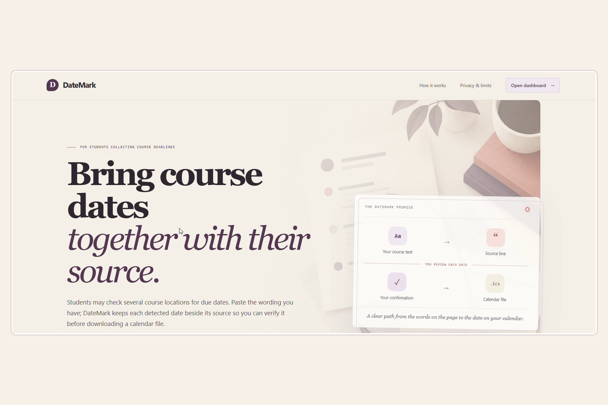
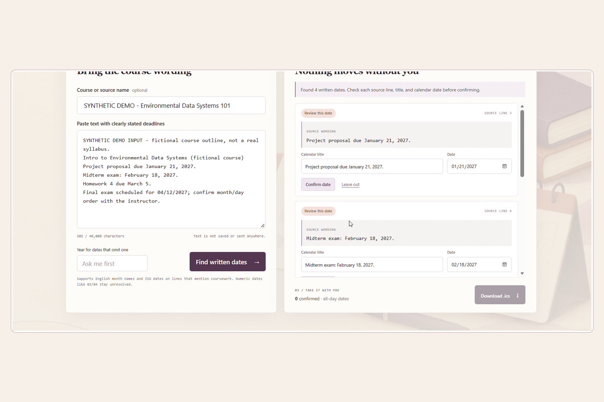
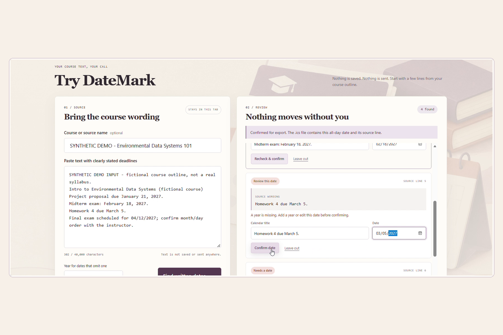
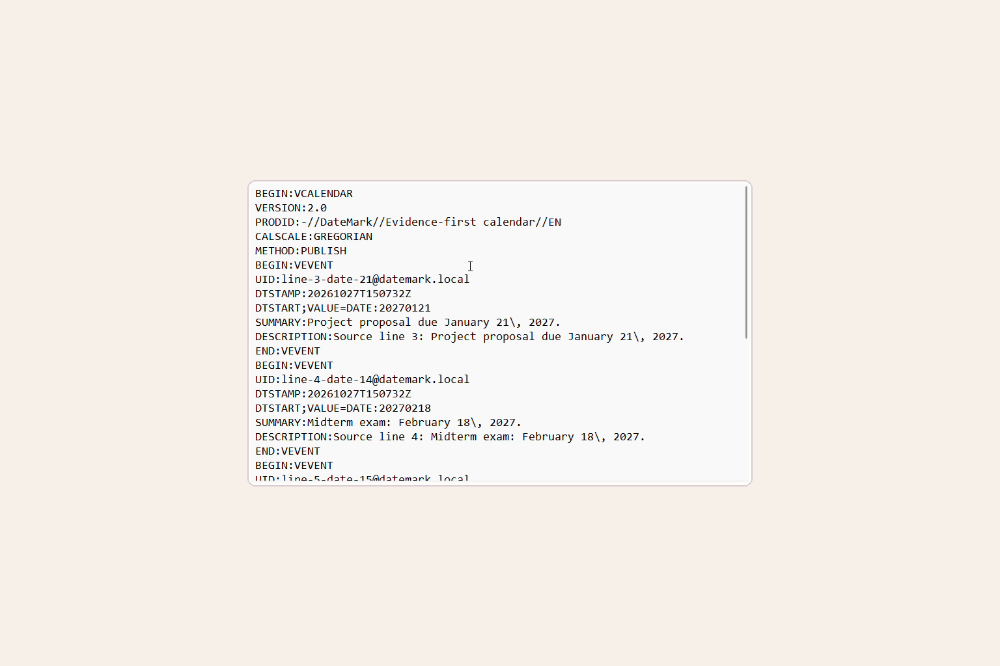

# DateMark

**Review a course deadline against its source. Export only what you confirm.**

DateMark is a browser-based student prototype that brings written deadlines from several course sources into one review session. It keeps each candidate attached to its named source and exact line, leaves uncertain dates for the student to resolve, and exports only items the student confirms to an iCalendar (`.ics`) file.

| Project link | URL |
|---|---|
| Live demo | [https://demonchant.github.io/DateMark/](https://demonchant.github.io/DateMark/) |
| Working dashboard | [https://demonchant.github.io/DateMark/dashboard.html](https://demonchant.github.io/DateMark/dashboard.html) |
| 2:34 video demo | [DateMark — LaunchPad Hacks demo](https://youtu.be/xHnsVDTlIQ4) |
| Source repository | [github.com/demonchant/DateMark](https://github.com/demonchant/DateMark) |

## The project story

### Inspiration

A 2024 study of 324 science students reported that assignment deadlines were their most important syllabus content, while students consulted multiple locations in their learning systems to find course information. That motivated a focused product question: can a student move a written deadline into a personal calendar while keeping the source wording close enough to check?

The study supports fragmented deadline lookup as a problem worth exploring; it does not prove DateMark is useful or that students want another tool. User interviews and measured product impact have not yet been completed. [Read the study in *Advances in Physiology Education*.](https://journals.physiology.org/doi/full/10.1152/advan.00004.2024)

### What it does

1. Paste course text that you have permission to use.
2. Find a limited set of written dates on coursework-related lines.
3. Review each candidate beside its exact source line; edit, confirm, or leave it out.
4. Download an `.ics` file containing only confirmed dates.

The student can add multiple separately named text sources to the same in-memory session. DateMark does not fetch course pages, identify which source is newest, resolve conflicting deadlines, or verify calendar import. The exported event description carries the source label, line number, and original wording. A missing year or ambiguous numeric date is not silently treated as correct.

### How it was built

The app uses HTML, CSS, and JavaScript. A deterministic parser runs in the browser, validates recognized dates, and retains source-line offsets. The review UI lets the student edit, confirm, or reject candidates. The exporter validates confirmed dates and serializes an all-day iCalendar file. A small Node.js built-in HTTP server is provided for local serving.

There is no app backend, database, account, AI feature, model request, calendar connection, or runtime third-party package. Pasted text is processed in the browser tab and is not sent to a DateMark server. Refreshing clears the in-memory session.

### Challenges and what we learned

Dates can be ambiguous even when a parser recognizes their shape. A date may omit its year or use numeric ordering that varies by locale. DateMark keeps these cases visible for human review and ties a candidate to its source line instead of implying the parser knows the authoritative deadline.

No real syllabus was available to share with permission, so the demo uses clearly labeled fictional course text. It demonstrates the interaction only; it is not user data, validation, or evidence of student outcomes.

### Accomplishments

The prototype implements a narrow path from multiple separately named pasted sources to source-linked candidates, user confirmation, and an actual `.ics` download with provenance. The currently linked video shows the previous single-source flow and a read-back of its generated calendar file; it does not yet demonstrate the newer multi-source workflow. Four genuine screenshots from that recording are included below and in [`media/`](media/).

### What is next

The next step is to test with students using course materials they are allowed to share. Feedback could guide broader date-format support and accessibility improvements. Any future calendar import or LMS connection would need explicit permissions and clear source provenance.

## Demo and screenshots

The video uses fictional, visibly labeled course text. It shows the problem, the landing page, dashboard, source review, confirmation, `.ics` download/read-back, technical approach, and limitations. The final card links the project demo and repository and credits the synthesized narration.

### Landing page



### Dashboard and date candidates



### Source review



### Calendar file read-back



The screenshots show the fictional demo only. They contain no real course document or student record.

## Run locally

The published static app needs only a modern browser. To serve the project locally, use Node.js 24 (the version used for local checks):

```powershell
node server.js
```

Open [http://localhost:4173/](http://localhost:4173/), select **Open dashboard**, and paste text you are authorized to use. Name the course/source, select **Find written dates**, then select **Add another source** to bring another course page into the same review list. Review source lines and dates, confirm the entries you want, and download the `.ics` file. Its event descriptions retain the source label and line. No API key, account, or package installation is required to run the product.

For the test commands, install the development dependency from `package.json` with `npm install`. The pinned `@playwright/test` package is for browser tests only; it is not shipped in the app.

## Built with and credits

- **Product:** HTML, CSS, JavaScript, browser `Blob` download API, iCalendar format.
- **Local serving:** Node.js built-in HTTP server.
- **Hosting:** GitHub Pages with GitHub Actions (`actions/configure-pages`, `actions/upload-pages-artifact`, `actions/deploy-pages`).
- **Browser test tooling:** `@playwright/test` 1.64.1 development dependency; no runtime packages.
- **Generated illustrations:** the two landing/dashboard illustrations were supplied for this project by the entrant. The exact image-generation service/model was not recorded in this repository; add its name to the Devpost credits if known and required by its terms.
- **AI assistance:** OpenAI Codex assisted with research, implementation, and documentation. The shipped product has no AI feature or model/API call.
- **Video narration:** Microsoft Edge TTS, voice `en-NG-EzinneNeural`.
- **Dataset/course material:** none. The demo course text is fictional and labeled synthetic.

No third-party runtime library, dataset, course document, or pre-existing application code is bundled.

## Event fit and work window

LaunchPad Hacks asks for a working technology prototype, a clear account of event-period work, an accessible demo or walkthrough, setup steps, screenshots, a project/source link where possible, and attribution for third-party material and AI assistance. DateMark implementation began on **October 27, 2026**, during the published hacking window of **October 16–November 20, 2026**. The prototype and submission materials should only claim work actually completed in that window.

The Devpost story should include the entrant and any teammates. The repository maintainer is GitHub user [`@demonchanta`](https://github.com/demonchanta); use the actual eligible participant names in the Devpost team field rather than inferring names from a handle. Each participant must meet the event’s student, age-of-majority, and geographic requirements. Companies and organizers/judges are not eligible to compete.

Submission closes **November 20, 2026 at 5:00 PM Eastern Time**. Online judging is **November 21 at 9:00 AM through November 25 at 5:00 PM Eastern Time**. Keep the demo and judging links accessible throughout that period. See the [official LaunchPad Hacks rules](https://launchpad-hacks.devpost.com/rules).

## Judging criteria

The event scores each criterion equally from 1 to 5:

- **Innovation & Originality:** a deliberately focused source-linked review flow. Related syllabus-to-calendar tools exist; DateMark does not claim uniqueness.
- **Usefulness & Impact:** addresses the manual handoff from course wording to a calendar. User demand and impact remain unvalidated.
- **Implementation & Functionality:** deterministic date parsing, source-line retention, editable review, confirmation, and `.ics` export are implemented.
- **Design & Presentation:** a landing page introduces the workflow and a separate dashboard demonstrates it, with explicit limitations and source evidence.

## Limitations and verification status

- Only English month-name and ISO dates on coursework-related lines are supported. Numeric and relative dates, missing years, scanned PDFs, LMS sync, change detection, conflicting-source resolution, reminders, cloud storage, and multi-user collaboration are outside this version.
- Exported events are all-day events; no time or timezone is inferred. DateMark does not verify an external calendar import.
- User demand and performance on a representative syllabus corpus have not been measured.
- Local parser checks (7 cases), HTTP smoke checks, JavaScript syntax checks, and Docker Compose syntax validation were recorded in [`evidence/local-verification.md`](evidence/local-verification.md). Those checks do not establish user impact or browser-rendered accessibility.
- The Playwright browser suite remains **BLOCKED** in the recorded environment because Docker engine and package-registry access were unavailable. No successful browser E2E run is claimed.
- The user reports the Pages site is live. Confirm the current landing and dashboard URLs load before final submission; the repository contains their published source and the Pages workflow.

## Further repository material

- [`docs/deployment.md`](docs/deployment.md) — local serving, Pages deployment, and configuration status.
- [`tests/`](tests/) — deterministic parser and HTTP smoke checks.
- [`evidence/`](evidence/) — verification index and recorded results/limits.
- [`media/`](media/) — submission screenshots.

The GitHub Pages workflow publishes only the app files, dashboard, source assets, and illustrations. It does not publish the Build Standard, Rebuild Playbook, research notes, tests, evidence, or this README as part of the hosted app.
